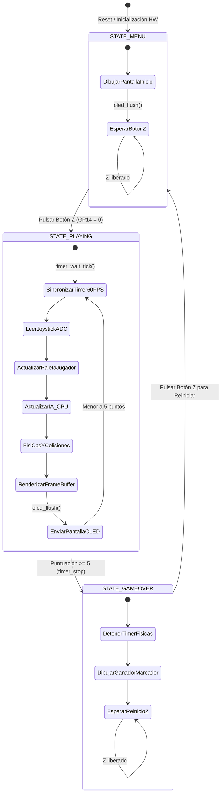

# Reporte Técnico: Videojuego Pong en Ensamblador ARM Bare-Metal
**Curso:** Arquitectura de Computadores II  
**Plataforma de Hardware:** Raspberry Pi Pico H (Microcontrolador RP2040 - ARM Cortex-M0+)  
**Periféricos:** Pantalla OLED SH1106 128x64 I2C (1.3") y Joystick Analógico KY-023  
**Lenguaje:** 100% Ensamblador ARMv6-M Puro (`.s`) — Sin bibliotecas de alto nivel ni SDK  

---

## 1. Descripción del Proyecto

El objetivo de este proyecto es diseñar, estructurar e implementar el videojuego clásico bidimensional **Pong** interactuando directamente con el hardware a nivel de registros en un microcontrolador de arquitectura ARM (RP2040, dual core Cortex-M0+). 

El sistema prescinde totalmente de sistemas operativos comerciales (bare-metal) y prohíbe el uso de bibliotecas de abstracción como el SDK oficial de Raspberry Pi o el entorno Arduino. Toda la inicialización de buses, temporizadores, conversores analógico-digitales, gestión de memoria gráfica (framebuffer) y lógica física del juego está escrita en lenguaje ensamblador modular.

---

## 2. Esquema Electrónico y Conexionado de Hardware

### 2.1 Tabla de Conexiones Físicas

| Dispositivo | Pin del Módulo | Pin Pico H | Función en RP2040 | Descripción / Configuración |
| :--- | :--- | :--- | :--- | :--- |
| **OLED SH1106** | **SDA** | **GP4** (Pin 6) | `I2C0 SDA` | Línea de datos I2C (Función 3 en IO_BANK0) |
| **OLED SH1106** | **SCL** | **GP5** (Pin 7) | `I2C0 SCL` | Línea de reloj I2C (Función 3 en IO_BANK0) |
| **OLED SH1106** | **VCC** | **3V3(OUT)** (Pin 36) | Alimentación | 3.3V DC |
| **OLED SH1106** | **GND** | **GND** (Pin 38) | Tierra | Masa común del circuito |
| **Joystick KY-023** | **VRX** | **GP26** (Pin 31) | `ADC0` | Eje analógico X (Conversor ADC Canal 0) |
| **Joystick KY-023** | **VRY** | **GP27** (Pin 32) | `ADC1` | Eje analógico Y (Conversor ADC Canal 1) |
| **Joystick KY-023** | **SW (Z)** | **GP14** (Pin 19) | `SIO GPIO14` | Botón pulsador con resistencia interna Pull-Up |
| **Joystick KY-023** | **+5V / VCC** | **3V3(OUT)** (Pin 36) | Alimentación | 3.3V DC (Referencia para potenciómetros ADC) |
| **Joystick KY-023** | **GND** | **GND** (Pin 38) | Tierra | Masa común del circuito |

### 2.2 Diagrama Esquemático

```
              +----------------------------------+
              |     Raspberry Pi Pico H (RP2040) |
              |                                  |
              |     [GP4] Pin 6  ---------------> SDA (OLED SH1106 1.3")
              |     [GP5] Pin 7  ---------------> SCL (OLED SH1106 1.3")
              |     [GP14] Pin 19 <-------------- SW  (Botón Z Joystick)
              |     [GP26] Pin 31 <-------------- VRX (Joystick KY-023)
              |     [GP27] Pin 32 <-------------- VRY (Joystick KY-023)
              |     [3V3] Pin 36 ---------------> VCC (Alimentación 3.3V)
              |     [GND] Pin 38 ---------------> GND (Masa Común)
              +----------------------------------+
```

---

## 3. Mapa de Memoria del Sistema (Memory Map)

La arquitectura de memoria del RP2040 se compone de memoria Flash externa mapeada vía QSPI XIP (Execute-In-Place) a partir de `0x10000000`, y 264 KB de memoria interna SRAM distribuida a partir de `0x20000000`.

### 3.1 Distribución en Memoria Flash (ROM / XIP - Base: `0x10000000`)

```
+---------------------+ 0x10000000
| Boot Stage 2        | 256 bytes (.boot2)
| (W25Q080 QSPI Init) | Contiene código de arranque rápido y Checksum CRC-32
+---------------------+ 0x10000100
| Vector Table        | 256 bytes (.vectors)
| (Cortex-M0+ NVIC)   | Puntero inicial SP y vectores de interrupción (VTOR)
+---------------------+ 0x10000200
| .text               | Código ejecutable ARMv6-M puro
| (Rutinas del juego) | Reset_Handler, main, timer, video, font, inputs
+---------------------+
| .rodata             | Datos constantes
| (Tablas y Cadenas)  | Tabla de fuentes 5x7 (font5x7_data), comandos OLED
+---------------------+
| __data_load__       | Imagen ROM de la sección .data
+---------------------+
```

### 3.2 Distribución en Memoria RAM (SRAM - Base: `0x20000000`)

```
+---------------------+ 0x20000000 (__data_start__)
| .data               | Variables inicializadas (copiadas desde Flash en el Reset)
+---------------------+ __bss_start__
| Framebuffer Gráfico | 1024 bytes (128x64 bits = 8 páginas x 128 bytes)
| framebuffer[1024]   | Mapeo 1:1 de los píxeles de la pantalla OLED
+---------------------+
| Variables de Estado | game_state, score_p1, score_cpu, winner,
| y Físicas           | ball_x, ball_y, ball_vx, ball_vy, p1_y, cpu_y,
|                     | game_tick_flag, tick_counter
+---------------------+ __bss_end__
| Heap libre          | Memoria dinámica disponible (no utilizada en bare-metal)
|         |           |
|         v           |
|         ^           |
|         |           |
| Pila del Sistema    | Crecimiento hacia direcciones bajas (Full Descending)
| (Stack Cortex-M0+)  | Alineación obligatoria a 8 bytes según AAPCS
+---------------------+ 0x20042000 (__stack_top)
```

---

## 4. Control de Periféricos y Mapeo Directo de Registros

En cumplimiento con las restricciones académicas de no usar el SDK ni bibliotecas externas, todos los periféricos se configuran escribiendo valores directos en las direcciones físicas y máscaras de bits:

### 4.1 Sub-sistema de Resets (`RESETS_BASE = 0x4000C000`)
Por defecto al arrancar el silicio RP2040, la mayoría de los periféricos están retenidos en estado de reset. Para habilitarlos:
* Se escribe la máscara en el alias de borrado atómico `RESETS_CLR_ALIAS = 0x4000F000`:
  * Bit 0: `ADC`
  * Bit 3: `I2C0`
  * Bit 5: `IO_BANK0`
  * Bit 8: `PADS_BANK0`
* Se monitorea `RESETS_RESET_DONE` (offset `0x08`) hasta que los bits correspondientes pasen a nivel lógico alto (1).

### 4.2 Control de PADS (`PADS_BANK0_BASE = 0x4001C000`)
* **GP14 (Pulsador Z):** Se configura en el pad correspondiente (offset `0x3C`) con resistencia Pull-Up interna habilitada (`PUE = 1`, bit 3) y buffer de entrada activo (`IE = 1`, bit 6) escribiendo `0x48`.
* **GP4 y GP5 (I2C0 SDA/SCL):** Se activan los buffers de entrada y resistencias pull-up auxiliares escribiendo `0x48` en offsets `0x14` y `0x18`.
* **GP26 y GP27 (Entradas Analógicas ADC):** Se desactiva el buffer digital de entrada (`IE = 0`) y se inhabilita la salida (`OD = 1`, bit 7) escribiendo `0x80` para evitar consumo espurio e interferencias de ruido en la lectura analógica.

### 4.3 Matriz de Funciones GPIO (`IO_BANK0_BASE = 0x40014000`)
* **GP14:** Registro `GPIO14_CTRL` (offset `0x74`), se selecciona Función 5 (`SIO - Single-cycle I/O`).
* **GP4 y GP5:** Registros `GPIO4_CTRL` (`0x24`) y `GPIO5_CTRL` (`0x2C`), se selecciona Función 3 (`I2C0`).
* **GP26 y GP27:** Se configuran con función `0x1F` (`NULL`) para desacoplarlos de los bloques lógicos digitales.

### 4.4 Conversor Analógico-Digital (`ADC_BASE = 0x4004C000`)
* **Habilitación:** Se escribe `1` en `ADC_CS` (offset `0x00`, bit 0 `EN`).
* **Disparo de Lectura:**
  * Para VRX (Canal 0): Se escribe `0x0005` (Canal 0, `START_ONCE = 1`, `EN = 1`).
  * Para VRY (Canal 1): Se escribe `0x1005` (Canal 1 en bits 14:12, `START_ONCE = 1`, `EN = 1`).
* **Lectura:** Se espera a que el bit 8 (`READY`) sea 1 y se leen los 12 bits de resolución (0 a 4095) en `ADC_RESULT` (offset `0x04`).

### 4.5 Controlador I2C Synopsys DesignWare (`I2C0_BASE = 0x40044000`)
* `IC_ENABLE` (`0x6C`): Se deshabilita (`0`) para configuración y se habilita (`1`) al finalizar.
* `IC_CON` (`0x00`): Configurado en `0x65` (Modo Maestro, Velocidad Rápida 400 kHz, Re-arranque habilitado, Esclavo deshabilitado).
* `IC_TAR` (`0x04`): Dirección del SH1106 fijada en `0x3C`.
* `IC_FS_SCL_HCNT` (`0x1C`) y `IC_FS_SCL_LCNT` (`0x20`): Tiempos de alto y bajo de reloj fijados en 14 y 18 ciclos para 400 kHz a reloj base.
* `IC_DATA_CMD` (`0x10`): Se transmiten los comandos con prefijo de control `0x00` y datos del framebuffer con prefijo `0x40`. El último byte de cada paquete activa el bit 9 (`STOP = 0x200`).

### 4.6 Temporizador Hardware RP2040 (`TIMER_BASE = 0x40054000`) y NVIC
* El bucle del juego opera gobernado por el módulo `ALARM0`.
* Período de interrupción programado a **16,666 µs** (equivalente a 60 FPS exactos).
* Se habilita la interrupción en el controlador de interrupciones de ARM Cortex-M0+ (`NVIC_ISER = 0xE000E100`, Bit 0 para `TIMER_IRQ_0`).
* La rutina de servicio (`TIMER_IRQ_0_Handler`):
  1. Limpia el flag de interrupción escribiendo en `TIMER_INTR` (bit 0).
  2. Suma el intervalo de 16,666 µs a la marca de tiempo leída de `TIMER_TIMELR` y lo escribe en `TIMER_ALARM0`.
  3. Establece la variable volatile `game_tick_flag = 1`.
* El bucle principal sincroniza la física mediante la instrucción de bajo consumo `wfi` (Wait For Interrupt), garantizando cero consumo de ciclos en retrasos vacíos (delay loops).

---

## 5. Máquina de Estados del Videojuego

El flujo de ejecución del juego Pong se modela mediante una máquina de estados finita (FSM) determinista:



### 5.1 Reglas y Lógica de Colisión Implementada
* **Paleta Jugador (Izquierda, X=4..7):** Mapeo fluido del conversor ADC de 12 bits (0 a 4095) a la coordenada vertical `p1_y` (rango 1 a 49).
* **Paleta IA Rival (Derecha, X=121..124):** Algoritmo autónomo predictivo que rastrea suavemente la coordenada vertical de la pelota cuando esta viaja hacia su campo.
* **Rebotes Angulares:** Si la pelota golpea el extremo superior de una paleta, adquiere componente vertical hacia arriba (`vy = -1`); si impacta el centro o zona inferior, se refleja hacia abajo (`vy = +1`).
* **Condición de Fin de Partida:** El primer jugador en alcanzar 5 puntos detiene el hardware timer y pasa al estado de Game Over.

---

## 6. Cálculo de Tiempos de Refresco y Rendimiento

### 6.1 Temporizador de Físicas
$$\text{Período} = \frac{1}{\text{Frecuencia}} = \frac{1}{60\text{ Hz}} = 16,666.\bar{6}\ \mu\text{s}$$

El registro `TIMER_ALARM0` se programa para disparar exactamente cada **16,666 microsegundos**, sincronizando el motor de colisiones y movimiento.

### 6.2 Ancho de Banda y Tasa de Refresco de Pantalla (I2C)
* **Resolución:** 128 columnas $\times$ 64 filas = 8,192 píxeles.
* **Organización:** 8 páginas verticales de 128 bytes cada una = **1,024 bytes** de Framebuffer.
* **Sobrecarga por página en controlador SH1106:**
  * Paquete de comando: 1 byte control (`0x00`) + 3 bytes de configuración (dirección de página, columna baja offset 2, columna alta) = 4 bytes.
  * Paquete de datos: 1 byte control (`0x40`) + 128 bytes de datos = 129 bytes.
  * Total por página = $4 + 129 = 133$ bytes.
  * Total por cuadro completo = $133 \times 8 = 1,064$ bytes.
* **Transmisión I2C a 400 kHz (Fast-Mode):**
  * Cada byte en I2C requiere 9 pulsos de reloj (8 bits + 1 bit ACK).
  * Bits por cuadro $\approx 1,064 \times 9 + \text{condiciones START/STOP} \approx 9,600\text{ bits}$.
  * Período de reloj I2C a 400 kHz = $2.5\ \mu\text{s}$.
  * Tiempo de actualización de un cuadro completo:
$$T_{\text{frame}} \approx 9,600 \times 2.5\ \mu\text{s} = 24.0\text{ ms}$$
* **Tasa máxima de refresco libre de parpadeo (Flicker-Free):**
$$\text{FPS}_{\text{máx}} = \frac{1}{0.024\text{ s}} \approx 41.6\text{ FPS}$$
Dado que $41.6\text{ FPS} > 30\text{ FPS}$, la pantalla opera de manera continua sin flickering ni saltos visuales.

---

## 7. Estándar de Llamadas ARM (AAPCS) y Manejo de la Pila

El código fuente respeta rigurosamente las especificaciones del estándar oficial **AAPCS (ARM Architecture Procedure Call Standard)**:
* **Argumentos y Valores de Retorno:** Los primeros cuatro argumentos enteros se pasan en los registros `r0`, `r1`, `r2` y `r3`. El valor de retorno se entrega en `r0`.
* **Registros Preservados (Callee-Saved):** Los registros `r4`, `r5`, `r6`, `r7` y `lr` se guardan en la pila al inicio de cada subrutina mediante `push {r4-r7, lr}` y se restauran al salir mediante `pop {r4-r7, pc}`.
* **Alineación de la Pila:** La pila se mantiene siempre alineada a 8 bytes en las llamadas a funciones externas, previniendo excepciones de desalineación en el procesador Cortex-M0+.

---

## 8. Estructura Modular del Proyecto

| Archivo | Rol y Descripción |
| :--- | :--- |
| `boot2.s` | Cargador de segunda etapa (256 bytes) para configurar la Flash SPI en modo Quad-Read continuo con checksum CRC-32. |
| `crt0.s` | Código de arranque, tabla de vectores de interrupción para Cortex-M0+, inicialización de secciones `.data` y `.bss`, y configuración del registro VTOR. |
| `timer.s` | Controlador bare-metal del temporizador hardware de 64 bits (`ALARM0`) e interrupciones periódicas mediante el NVIC. |
| `inputs.s` | Controlador de periféricos de entrada: lectura de botón Z en GP14 (SIO) y muestreo analógico de 12 bits en GP26/GP27 (ADC). |
| `video.s` | Controlador bare-metal I2C0 para pantalla OLED SH1106 (128x64), gestión de Framebuffer en RAM y primitivas gráficas. |
| `font.s` | Tabla de mapas de bits tipográficos 5x7 y rutinas de renderizado de cadenas de texto y marcadores numéricos. |
| `main.s` | Máquina de estados principal, bucle de juego sincronizado a 60 FPS, física de rebotes, inteligencia artificial y HUD. |
| `memmap.ld` | Script del enlazador (Linker Script) que define los mapas de Flash (2MB) y SRAM (264KB). |
| `uf2conv.py` | Conversor en Python de archivos `.bin` al formato oficial de actualización de firmware `.uf2` para RP2040. |
| `build.bat` | Script automatizado de compilación y enlace que genera el binario y lo transfiere a la Raspberry Pi Pico. |

---

## 9. Instrucciones de Compilación y Demostración

1. Conectar la **Raspberry Pi Pico H** a la PC manteniendo pulsado el botón blanco **BOOTSEL** para que monte la unidad `RPI-RP2` (ej. `D:\`).
2. Abrir una terminal en el directorio del proyecto y ejecutar:
   ```cmd
   build.bat
   ```
3. El script ensamblará automáticamente todos los archivos `.s`, enlazará con `memmap.ld`, generará `pong.uf2` y lo copiará directamente a la unidad de la Pico.
4. La placa se reiniciará inmediatamente mostrando la pantalla de inicio estática **"PONG ARM - ARQUITECTURA II"**.
5. Al pulsar el botón Z (SW en GP14), comienza la partida contra la máquina a 60 FPS, controlando la paleta con el joystick analógico KY-023.

